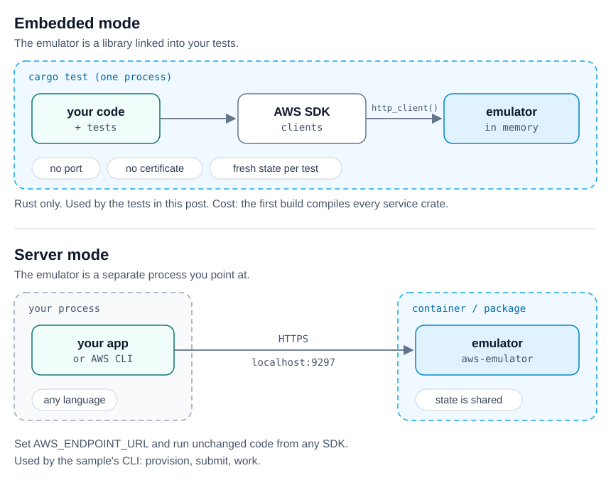
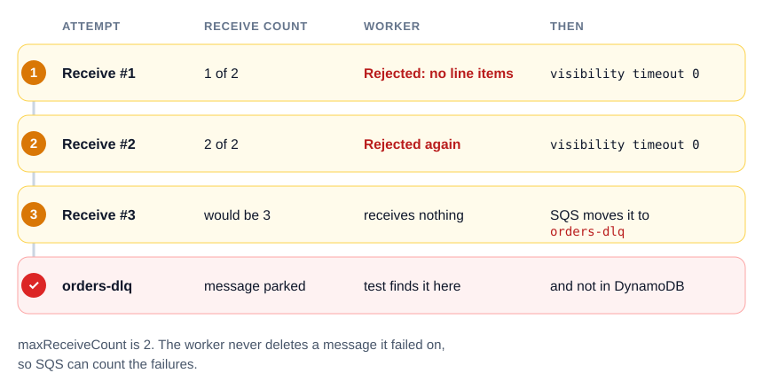
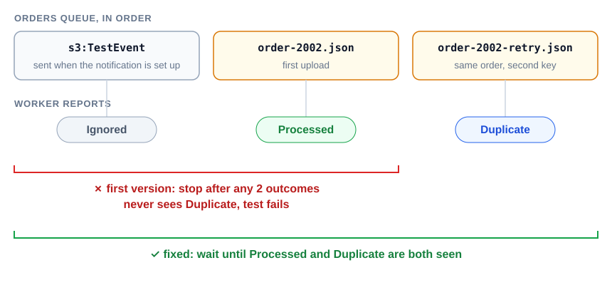

**Mocks are fast and wrong. A real AWS account is right and slow. Most event-driven code gets tested with neither.**

## The gap between unit tests and production

Take a common shape: a file lands in S3, a notification goes to SQS, a worker picks it up, writes to DynamoDB, and fans a message out through SNS. Each line of code is easy to unit-test. The bugs live in the wiring:

* the bucket notification filter doesn't match the key you actually upload,
* the queue policy doesn't let S3 (or SNS) send to it,
* the redrive policy never fires because the worker deletes messages it failed on,
* SQS delivers the same message twice and you charge the customer twice.

A mock library won't catch these, because a mock does whatever you told it to. A shared dev account will catch them, but it's slow, it costs money, it needs credentials in CI, and two test runs stomp on each other's queues.

## AWS Emulator

[AWS Emulator](https://github.com/aws/aws-emulator) is a local implementation of the AWS APIs, generated from the same Smithy models the SDKs are built from. It runs two ways:

* **Server mode:** a process (a package on Linux, a container on Windows and macOS) serving HTTPS on `localhost:9297`. You set `AWS_ENDPOINT_URL` and any SDK or the AWS CLI talks to it.
* **Embedded mode:** a Rust crate you add as a dev-dependency. Each test builds its own emulator in memory and hands its HTTP client to the SDK. There's no port, no certificate, no environment variable, and no shared state between tests.



Embedded mode is the interesting one, so that's what this post uses.

## The sample: an order pipeline

The full project is at [aws-emulator-order-pipeline](https://github.com/SeanieGleason/aws-emulator-order-pipeline).


A customer uploads an order document. The worker validates it, stores it once, writes a receipt, and announces it. An order that fails validation twice is moved by SQS to a dead-letter queue.

The app code doesn't know about the emulator. It takes an `SdkConfig` like any other AWS program:

```rust
pub fn from_config(config: &SdkConfig) -> Self {
    let s3_config = aws_sdk_s3::config::Builder::from(config)
        .force_path_style(true)
        .build();
    Self {
        s3: aws_sdk_s3::Client::from_conf(s3_config),
        sqs: aws_sdk_sqs::Client::new(config),
        sns: aws_sdk_sns::Client::new(config),
        dynamodb: aws_sdk_dynamodb::Client::new(config),
    }
}
```

Provisioning is plain SDK calls too, so it's tested along with everything else. The two parts most likely to go wrong are the queue policy and the redrive policy:

```rust
let orders_queue_url = create_queue(
    clients,
    &names.orders_queue,
    &[
        (QueueAttributeName::VisibilityTimeout, "30".to_string()),
        (
            QueueAttributeName::RedrivePolicy,
            json!({
                "deadLetterTargetArn": dead_letter_queue_arn,
                "maxReceiveCount": MAX_RECEIVE_COUNT.to_string(),
            })
            .to_string(),
        ),
    ],
)
.await?;
```

The worker deletes a message only when every order in it succeeded. On a rejection it sets the visibility timeout to zero so SQS hands it back right away, and the receive count climbs toward the redrive limit:

```rust
if message_outcomes.iter().any(|o| matches!(o, Outcome::Rejected { .. })) {
    clients.sqs.change_message_visibility()
        .queue_url(&resources.orders_queue_url)
        .receipt_handle(receipt_handle)
        .visibility_timeout(0)
        .send().await?;
} else {
    clients.sqs.delete_message()
        .queue_url(&resources.orders_queue_url)
        .receipt_handle(receipt_handle)
        .send().await?;
}
```

Duplicate delivery is handled at the table: the `PutItem` has `attribute_not_exists(order_id)` as its condition, and a `ConditionalCheckFailedException` means "already done", not "failed".

## Wiring the emulator into a test

Add the emulator as a dev-dependency. Pin it to a release commit so it isn't rebuilt every time `main` moves:

```toml
[dev-dependencies]
aws-emulator-embedded = { git = "https://github.com/aws/aws-emulator", rev = "<release commit>" }
```

Then give the SDK the emulator's HTTP client and credentials instead of a network connector:

```rust
async fn sdk_config(emulator: &AwsEmulatorEmbedded) -> SdkConfig {
    aws_config::defaults(BehaviorVersion::latest())
        .http_client(emulator.http_client())
        .credentials_provider(emulator.aws_credentials_provider())
        .region(Region::new("us-east-1"))
        .load()
        .await
}

async fn fresh_pipeline(prefix: &str) -> (AwsEmulatorEmbedded, Clients, Resources) {
    let emulator = AwsEmulatorEmbedded::new(EmbeddedOptions::default().telemetry(Telemetry::Off));
    let clients = Clients::from_config(&sdk_config(&emulator).await);
    let resources = provision(&clients, &Names::with_prefix(prefix)).await.expect("provision");
    (emulator, clients, resources)
}
```

`Telemetry::Off` is my choice for this sample; the default is on. You can also turn on `Authentication::On`, which makes the emulator reject any request not signed with the credentials it issued.

## The tests

**The happy path, end to end.** Upload an order, run the worker, then check every side effect: the DynamoDB item, the receipt object, and the SNS message arriving on the subscribed queue.

```rust
#[tokio::test(flavor = "multi_thread")]
async fn a_valid_order_is_stored_receipted_and_announced() {
    let (_emulator, clients, resources) = fresh_pipeline("valid").await;
    upload(&clients, &resources, "order-1001.json", json!({ /* two line items */ })).await;

    work_until(&clients, &resources, |seen| {
        seen.contains(&Outcome::Processed { order_id: "1001".into() })
    }).await;

    // DynamoDB item, receipt HeadObject, and the SNS → SQS notification
}
```

**The poison message.** Upload an order with no line items. The worker rejects it twice, and the next receive finds the orders queue empty because SQS moved the message to the dead-letter queue. That only works if the redrive policy, the ARN it points at, and the worker's "don't delete on failure" behaviour all agree. A mock would have accepted any of them being wrong.



**Redelivery.** Upload the same order under two keys. One is `Processed`, the other is `Duplicate`, and the table has one row.

This test failed on its first run, and the emulator was right. I had written it to stop after the worker reported any two outcomes. But when you configure a bucket notification, S3 sends an `s3:TestEvent` message to the queue, and my worker correctly reported it as `Ignored`. That used up one of the two slots before the duplicate arrived. The fix was to wait for the specific outcomes, not a count. A mock would never have shown me that.



**Isolation.** Provision a pipeline in one emulator, create a second emulator, and list its buckets. The list is empty. This is why the tests can run in parallel without unique names or cleanup code.

## Checking whether your app will work

The emulator doesn't cover everything yet, and the project says so. Every known gap is a file in the repository:

* `issues/things-that-do-not-work/` lists APIs and behaviours that are wrong today.
* `issues/things-that-now-work/` is where they move once fixed.

At the time of writing that's roughly 13,000 fixed entries and 7,000 open ones. Each release also publishes per-service fidelity scores. Before you adopt it, search the open issues for the operations your app uses. For this sample, the open S3→SQS items are about edge cases (S3 doesn't check that the queue policy grants it access, and the ETag in event payloads keeps its quotes), not the happy path. That's also the reason the sample sets the queue policies anyway: the same code has to work against real AWS, where those policies are enforced.

## The cost: the first build

Embedded mode compiles the emulator into your test binary, which means every service crate (there are more than 400). The first `cargo test` takes a long time and `target/` gets large. After that, incremental builds are fast. In practice:

* reuse one `CARGO_TARGET_DIR` across projects,
* cache `target/` (or use sccache) in CI,
* pin the emulator to a release commit.

Building from source is officially supported on Linux only, and I hit that limit: on Windows the build stops in a third-party dependency (`rustpython-host_env`) before reaching any of my code. Two things helped. First, seed your `Cargo.lock` from the emulator's, so your project resolves the same dependency versions it was tested with. Second, on Windows or macOS, run `cargo test` inside a Linux container:

```bash
docker run --rm -v "$PWD/..:/work" -w /work/aws-emulator-order-pipeline \
  -e CARGO_TARGET_DIR=/work/target-linux rust:latest cargo test
```

Give that container memory. With the 8 GB Docker Desktop has by default, the compiler was killed on the EC2 service crate, and later the whole Docker engine fell over while compiling the router that bundles every service. What got it through was 12 GB plus 24 GB of swap (set in `%UserProfile%\.wslconfig`), debug info off (`CARGO_PROFILE_DEV_DEBUG=0`), and one build job for the last few crates. After that, all five tests ran in under five seconds.

In CI, a standard GitHub-hosted Linux runner (16 GB) is enough. The sample repo has a workflow that checks out the emulator beside the project, pinned to a commit, and builds on the runner's larger `/mnt` disk. The build directory is too big for the Actions cache, so every run is a full cold build. If that matters, use a self-hosted runner with a persistent `target/`.

Or skip embedded mode, run the server-mode container, and point the same binary at it:

```bash
export AWS_ENDPOINT_URL=https://localhost:9297 AWS_REGION=us-east-1
cargo run -- provision
cargo run -- submit samples/order-1001.json
cargo run -- work
```

Unset `AWS_ENDPOINT_URL` and the same binary runs against your real account.

## Takeaways

* Test the wiring, not just the functions. That's where event-driven systems break.
* Keep the app unaware of the emulator. If it takes an `SdkConfig`, it can be tested this way.
* Use one emulator per test. Isolation is free, so don't share state you'll have to clean up.
* Read the open-issues list before you trust a green test.
